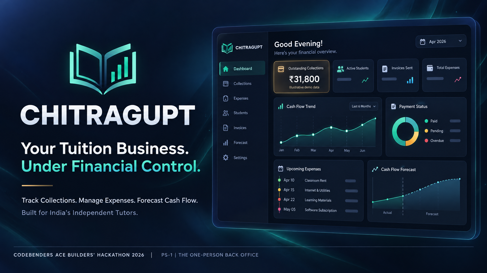

# Chitragupt

**The Divine Accountant for Your Tuition Business.**

Chitragupt is a back-office and cash-flow web app for independent home tutors and small tuition academies in India. It replaces the WhatsApp threads and paper notebook where fees are usually tracked, and turns them into a view of who owes money, how long it has been outstanding, and what cash position to expect over the next 30, 60 or 90 days.

Built for the Codebenders ACE Builders' Hackathon 2026, problem statement PS-1: The One-Person Back Office.

## Problem statement

A solo tutor runs a business with the admin of a small company and no staff. Fees arrive by UPI, cash and bank transfer on different dates, and are noted in several places. Common problems:

- It is hard to know, at a glance, which students are behind on fees and by how much.
- Overdue amounts are chased by hand, one parent at a time, with no record of when a reminder was sent.
- Rent, internet and assistant salaries fall due on fixed days, and the tutor cannot easily tell whether incoming fees will cover them.
- Payments are recorded late or not at all, so the books and the bank balance disagree.

## Our solution

Chitragupt keeps one record per student, invoice and payment, and computes everything from it on the server:

- Invoices carry a due date. Payments are recorded against them, and the paid amount, balance and status (paid, partial, unpaid, overdue) are derived from those payments.
- The dashboard lists overdue balances, sorted by how many days late they are, and groups them into aging buckets.
- Reminders are drafted as a short, editable WhatsApp message and opened in WhatsApp through a wa.me link. Each one is logged.
- A forecast projects the daily cash balance from opening cash, expected collections and upcoming bills, and shows the lowest point and the date it occurs.
- A "largest payer pays late" slider shows how the forecast changes if the biggest outstanding balance arrives later than due, and flags any bill that could not be paid from the balance at that point.
- Payment messages pasted from WhatsApp, such as "Aarav paid 3000 today", are parsed into a review card. Nothing is saved until the tutor confirms it.

## Key features

- **Financial dashboard and overdue collections.** Total overdue amount, number of overdue invoices, aging buckets (0-7, 8-15 and 16+ days) and a table of overdue invoices sorted by days overdue.
- **Student management.** A read-only list of students with parent name, phone and batch. Students are created through the API; the client has no add-student form.
- **Invoice creation and tracking.** Invoices can be created for a student with an amount, issue date and due date, and are listed with status, paid and balance amounts. A printable invoice view is available for each invoice via the browser's print dialog ("Save as PDF").
- **Payment recording.** Full or partial payments against an invoice, with a date and a method (UPI, Cash or Bank).
- **Paste-to-Ledger.** A text box on the dashboard. The message is parsed by fixed rules (no AI service) into a candidate student, amount, date and intent. A review card shows the invoice it would apply to. Confirm records the payment; Cancel discards it. Parsing never writes to the database.
- **WhatsApp payment reminders.** An editable draft per overdue invoice, a button that opens WhatsApp with the message filled in, and a logged reminder record.
- **30-, 60- and 90-day cash-flow forecast.** Projected daily balance chart, lowest balance and its date, total expected collections, and the largest payer.
- **Largest-payer delay simulation.** A 0 to 30 day slider that recomputes the forecast and marks any bill that would take the balance below zero.
- **Recurring expense management.** Bills have a name, amount, due date and a monthly-recurring flag. Recurring bills are included in the forecast. Bills are created through the API and the seed data; the client has no bills screen.
- **Monthly invoice generation.** One action creates an invoice for each student with a batch for a chosen month, using the batch's monthly fee. Students who already have an invoice for that month are skipped, so repeating the action does not create duplicates. The due day comes from the setting monthly_due_day, defaulting to 10.
- **Actions.** A prioritised list of today's actions: overdue invoices to chase, and a warning when cash is projected to go below zero, with an inline reminder draft for each chase item.
- **Demo data reset.** A "Reset demo data" control in the sidebar re-creates the synthetic sample data with dates relative to the current day.

## How Chitragupt works (typical tutor workflow)

1. Students and batches are set up once (through the API, or from the seed data for the demo).
2. At the start of each month the tutor generates this month's invoices. Each student gets one invoice for their batch's fee.
3. When a parent pays, the tutor pastes the WhatsApp message into Paste-to-Ledger, checks the review card and confirms, or records the payment manually on the Invoices screen.
4. The dashboard shows who is overdue and for how long. For each overdue invoice the tutor drafts a reminder, edits it if needed, and sends it through WhatsApp; the reminder is logged.
5. The forecast shows whether the expected collections, plus the opening cash, cover the upcoming bills. The slider shows the effect if the largest payer is late.
6. The Actions screen lists what to do today in priority order.

## Technology stack

| Layer | Technology | Where it is declared |
| --- | --- | --- |
| Frontend language | TypeScript 5.6 (client) | client/package.json |
| Frontend framework | React 18.3 with react-dom | client/package.json |
| Frontend build tool and dev server | Vite 5.4 with @vitejs/plugin-react | client/package.json, client/vite.config.ts |
| Styling | Tailwind CSS 3.4 with PostCSS and Autoprefixer | client/package.json, client/tailwind.config.js, client/postcss.config.js |
| Backend runtime | Node.js 22.13 or later (engines field) | server/package.json |
| Backend framework | Express 4 with cors | server/package.json |
| Backend language | TypeScript 5.7 run with tsx | server/package.json |
| Database | SQLite through Node's built-in node:sqlite module (DatabaseSync) | server/src/db.ts |
| Test runner | Node's built-in node:test, run with tsx --test | server/package.json |
| Root task runner | concurrently (runs server and client together) | package.json |

No external database server, AI service, payment gateway or cloud service is used. The WhatsApp integration only opens a wa.me link in the browser.

## System architecture

The app is two processes that run together in development.

- **Client (React, Vite, port 5173).** A single-page app with a sidebar for Dashboard, Invoices, Students, Forecast and Actions. It calls the API at /api. Vite proxies /api to the server, so the browser talks to one origin in development.
- **Server (Express, port 3001 by default).** A JSON REST API under /api. Route handlers are thin; the money logic lives in server modules as functions that take today's date as a parameter, which makes them testable without a clock.
- **Database (SQLite file).** Tables: batches, students, invoices, payments, bills, reminders and settings. Foreign keys are enforced. The database file is created on first start.

Money rules:

- Amounts are integer rupees. There is no floating-point money arithmetic.
- Invoice paid, balance, status and days overdue are computed by the server (invoiceService and money modules) and returned to the client. The client displays these values and does not recompute them.
- The forecast (server/src/forecast.ts) is a pure function. Its inputs are the opening cash, unpaid invoice balances with due dates, bills, a horizon and an extra delay for the largest payer.

Main API endpoints (all under /api):

| Method and path | Purpose |
| --- | --- |
| GET /api/health | Health check |
| GET, POST /api/batches | List or create batches |
| GET, POST /api/students | List or create students |
| GET, POST /api/invoices | List invoices (with paid, balance, status, days overdue) or create one |
| POST /api/invoices/generate-month | Create the month's invoices, skipping students who already have one |
| POST /api/invoices/:id/payments | Record a payment against an invoice |
| GET, POST /api/bills | List or create bills |
| GET, POST /api/reminders | List reminders or log a sent reminder |
| GET /api/settings, PUT /api/settings/opening_cash | Read settings; set the opening cash balance |
| GET /api/forecast?horizon=30\|60\|90&delay=0..30 | Cash-flow forecast |
| GET /api/actions | Today's prioritised actions |
| GET /api/dashboard/summary | Overdue total, overdue count, aging buckets and overdue rows |
| POST /api/ledger/parse | Parse a pasted message into candidates; writes nothing |
| POST /api/demo/reset | Re-create the synthetic demo data |

Payments are recorded through POST /api/invoices/:id/payments. The Paste-to-Ledger Confirm step calls the same payment flow.

## Project directory structure

    .
    ├── chitragupt-banner.png        Banner image shown at the top of this README
    ├── package.json                 Root scripts: dev, build, seed, start
    ├── package-lock.json
    ├── README.md
    ├── client/                      React + TypeScript + Vite + Tailwind frontend
    │   ├── index.html
    │   ├── package.json
    │   ├── tsconfig.json
    │   ├── vite.config.ts           Dev server on 5173, /api proxy to 3001
    │   ├── tailwind.config.js
    │   ├── postcss.config.js
    │   └── src/
    │       ├── main.tsx, App.tsx    Entry point and app shell (sidebar, navigation)
    │       ├── api.ts               API client and shared types
    │       ├── format.ts            ₹ and Indian date formatting
    │       ├── useAsync.ts          Loading and error hook
    │       ├── components/          Card, ErrorBox, StatusChip, ReminderPanel, PasteToLedger, PrintableInvoice, ForecastChart
    │       └── screens/             Dashboard, Invoices, Students, Forecast, Actions
    └── server/                      Express + node:sqlite backend
        ├── package.json
        ├── tsconfig.json
        ├── data/                    SQLite database file (created at runtime, git-ignored)
        └── src/
            ├── index.ts             Express app and all routes
            ├── db.ts                Database connection and schema
            ├── seed.ts              Synthetic demo data and demo reset
            ├── money.ts             Status, overdue days, date and ₹ formatting
            ├── invoiceService.ts    Invoices, payments and computed status
            ├── forecast.ts          Pure cash-flow forecast
            ├── forecastService.ts   Forecast inputs read from the database
            ├── actionsService.ts    Today's actions
            ├── dashboardService.ts  Dashboard summary and aging buckets
            ├── monthlyService.ts    Monthly invoice generation
            ├── ledgerParser.ts      Rule-based paste parser (pure)
            ├── ledgerService.ts     Parser wired to the database (read-only)
            └── *.test.ts            node:test suites

## Installation and setup (Windows)

Requirements: Node.js 22.13 or later and npm. Check with:

    node --version
    npm --version

Install dependencies from the project root, then for each part:

    npm install
    npm --prefix server install
    npm --prefix client install

## Environment configuration

The app runs without any environment file. These variables are read by the code:

| Variable | Used by | Default | Purpose |
| --- | --- | --- | --- |
| PORT | server/src/index.ts | 3001 | Port the API listens on |
| CHITRAGUPT_DB | server/src/db.ts | server/data/chitragupt.db | Path of the SQLite database file; tests point this at a temporary file |

The Vite dev proxy target is fixed to http://localhost:3001 in client/vite.config.ts. If you change PORT, change that proxy target as well.

The app setting monthly_due_day (stored in the settings table, not an environment variable) sets the due day for generated monthly invoices. It defaults to 10 and must be between 1 and 28.

## Running the project locally

From the project root, start the API and the client together:

    npm run dev

Then open http://localhost:5173 in a browser. The API runs on http://localhost:3001; check it with http://localhost:3001/api/health.

To run the parts separately:

    npm --prefix server run dev
    npm --prefix client run dev

To start the API without the file watcher:

    npm run start

## Production build

    npm run build

This runs the client build (TypeScript check, then Vite production build into client/dist). To build the server TypeScript into server/dist:

    npm --prefix server run build

The server is started from source with tsx (npm run start); it is not bundled.

## Running automated tests

    npm --prefix server test

The test script runs five suites with node:test: forecast, money, monthly invoices, ledger parsing and the dashboard summary. The monthly tests use a temporary database file and do not touch the demo database. The client has no automated test suite.

## Database and demo data

The database is a single SQLite file at server/data/chitragupt.db (or the path in CHITRAGUPT_DB). The schema is created on first start. If the students table is empty when the server starts, the demo data is seeded automatically.

The demo data is synthetic. It contains:

- 3 batches and 12 students with invented names, phone numbers and parent names.
- Invoices across several months, with paid, partial and overdue examples. One unpaid invoice is 18 days overdue.
- Recurring monthly bills (rent, internet, assistant salary and electricity) and a one-off bill.
- An opening cash balance used as the forecast starting point.

Dates in the demo data are relative to the day the data is seeded, so overdue ages stay realistic. The "Reset demo data" control (or POST /api/demo/reset) deletes all data and re-seeds it. Reset removes any changes you made, so use it only for the demo.

Do not enter real phone numbers, names or payment details into a demo database that is shared publicly.

## Hackathon demonstration walkthrough

Suggested order, using the seeded demo data:

1. Open the Dashboard. Point out the total overdue amount, the overdue count, the aging buckets and the overdue table sorted by days overdue.
2. Open the reminder draft for the most overdue invoice. Edit the message, then use "Send on WhatsApp", which opens WhatsApp with the message filled in. The reminder is logged.
3. On the Dashboard, paste "Aarav paid 3000 today" into Paste-to-Ledger and press Parse / Review Payment. Show the review card and the invoice it applies to. Confirm only on demo data, because it records a payment.
4. Open Invoices. Use "Generate this month's invoices" to show that a second run creates no duplicates. Open an invoice's printable view and print or save it as PDF.
5. Open Forecast. Show the 30, 60 and 90-day horizons and the lowest balance and date. Move the largest-payer slider from 0 to 15 days and show any unaffordable bill that appears.
6. Open Actions. Show the prioritised list and the cash warning.
7. Press "Reset demo data" to return to the sample state.

## Known limitations

- No login or user accounts. The app is built for a single tutor on a trusted machine.
- No bills screen and no add-student or edit-student forms. Students and bills are created through the API or the seed data.
- Forecasts are projections from the invoices, payments and bills that are entered. They are not guaranteed outcomes and do not include income or expenses that are not recorded.
- Paste-to-Ledger uses fixed rules. It handles the message forms it was designed for and asks for a choice when a name is ambiguous; unusual wording will be missed.
- Paste-to-Ledger always records the payment method as UPI.
- Reminders open WhatsApp through a wa.me link. The app does not send messages itself and cannot confirm that the parent received one.
- PDF output is produced by the browser's print dialog. There is no server-side PDF generation.
- SQLite file storage on one machine; no backups, multi-user access or cloud hosting.
- Money is stored in whole rupees. Paise are not supported.
- The client has no automated tests. Server tests cover the calculation logic, not the screens.
- Only the Paste-to-Ledger control and the forecast horizon buttons have been checked in a browser. Full end-to-end runs of every workflow have not been recorded.

## Future improvements

- Bills and student management screens, with editing and deletion.
- Login and separate tutor accounts.
- Backup and export of the database.
- Recording the payment method selected in Paste-to-Ledger, instead of always UPI.
- Server-side PDF invoices.
- Automated end-to-end tests for the screens.

## Hackathon information

- Event: Codebenders ACE Builders' Hackathon 2026
- Problem statement: PS-1, The One-Person Back Office
- Project: Chitragupt
- Target users: independent home tutors and small tuition academies in India

## Repository information

- Repository name: chitragupt
- Package names: chitragupt (root), chitragupt-server, chitragupt-client
- Demo deployment: none. The app is run locally.

## License

No license file is included in this repository.
